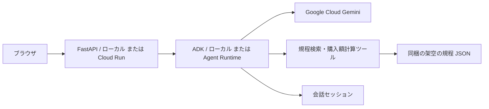
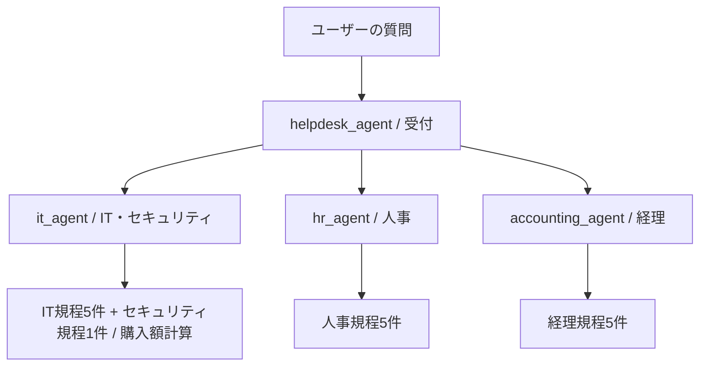

# 社内ヘルプデスク / Google Agent Platform PoC

日本語で社内の手続きを相談するサンプルアプリです。Google ADKで作った受付エージェントが質問をIT・人事・経理の担当エージェントへ振り分けます。各担当は架空の規程を検索し、根拠を添えて回答します。PC購入ではIT担当がPythonのツールで税込合計と承認者を計算します。

「税込18万円のPCを2台購入したい」と入力すると、デモ規程では合計36万円、承認者は直属の上長と部門責任者になります。申請・発注は実行しません。

## まず動かす

リポジトリのルートから実行します。既定の `local` モードはGoogle CloudのGeminiを利用するため、プロジェクト設定と認証が必要です。

```bash
uv python install 3.13
uv sync --locked --group dev
cp .env.example .env
```

[セットアップ・デプロイ手順](docs/setup-deploy.md)の「Google Cloudの準備」を実施し、`.env` の `GOOGLE_CLOUD_PROJECT` を実際のプロジェクトIDに変更します。`APP_BACKEND=local` のまま起動します。既存の `.env` がある場合はコピーせず、その設定を使ってください。

```bash
uv run --locked python main.py
```

ブラウザで **http://localhost:8080** を開きます。8080番が使用中なら `PORT=8765 uv run --locked python main.py` とし、http://localhost:8765 を開いてください。

**ローカルでの動作確認が済んだら、[CLIでのデプロイ手順](docs/cli-deploy.md)へ進んでください。** `gcloud` と公式ADK CLIで、API・IAM設定、Agent RuntimeとCloud Runへの配置、会話継続の確認、更新・削除まで実行できます。独自Pythonスクリプトを使う方法とIAP設定は [Cloud Run + Agent Runtimeの手順](docs/cloudrun-agent-runtime.md)にあります。

## 実行モードと構成

| APP_BACKEND | 実行場所 | モデル / 会話状態 | 用途 |
| --- | --- | --- | --- |
| `local` | ローカルADK | Google CloudのGemini / メモリ内 | 実際のAIとツールを開発 |
| `remote` | Agent PlatformのAgent Runtime | Gemini / マネージドセッション | クラウド上のエージェントを利用 |

クラウド版では、エージェントをAgent Runtimeに、FastAPIの画面をCloud Runにデプロイします。Agent Runtimeだけをデプロイし、画面を手元で起動することもできます。



公式の[Agent Platform概要](https://docs.cloud.google.com/gemini-enterprise-agent-platform/overview?hl=ja)にあるADKとAgent Runtimeを利用しています。SDKのパッケージ名は `google-cloud-aiplatform`、リソース名は `reasoningEngines` です。クラウドへの接続は、固定SDK 1.165.1に同梱された `agentplatform.Client().agent_engines` を使います。ADKの実行・デプロイ用ラッパーは `vertexai.agent_engines.AdkApp` を使用します。[公式SDKリポジトリ](https://github.com/googleapis/python-aiplatform)

## エージェントチームとADK Webでの確認

[helpdesk/agent.py](helpdesk/agent.py) の `create_agent()` は、受付と3つの担当を作り、受付の `sub_agents` に登録して返します。`root_agent = create_agent()` はADK Webの入口です。localとデプロイスクリプトも同じ関数を呼ぶため、同じチーム構成を使います。



| 担当 | 検索ツール | 主な規程 |
| --- | --- | --- |
| IT・セキュリティ | `search_it_knowledge` | VPN、PC購入、ソフトウェア、端末紛失、アカウント、不審メール |
| 人事 | `search_hr_knowledge` | 在宅勤務、有給休暇、フレックス、残業、育児・介護 |
| 経理 | `search_accounting_knowledge` | 経費締切、出張・宿泊、会食、領収書、請求書 |

各担当の検索は担当カテゴリに限定しています。受付には規程検索・計算ツールを持たせず、担当の `description` と受付の `instruction` を基にLLMが `transfer_to_agent` で引き継ぎます。話題が変わると担当から受付へ戻して再振り分けし、担当内の追加質問はその担当が続けて回答します。複数分野を一度に尋ねた場合は、最初に相談したい分野を確認します。[ADK公式のチーム構成](https://adk.dev/tutorials/agent-team/#step-3-building-an-agent-team-delegation-for-greetings-farewells)

3担当は担当分野の最新の一般情報をGoogle検索できます。独自関数と共存させるため、`GoogleSearchTool(bypass_multi_tools_limit=True)` を使い、ADKが検索専用エージェントを `google_search_agent` ツールとして包みます。社内のルールは規程検索を根拠とし、Web情報は出典名・URLを添えた一般情報として区別します。[ADKの検索ツールの制約と回避方法](https://adk.dev/tools/limitations/#workaround-2-bypass_multi_tools_limit)

Google Cloudの認証と `.env` の設定後、リポジトリのルートで実行します。

```bash
uv run --locked adk web . --port 8787
```

http://localhost:8787 を開いて `helpdesk` を選びます。1つの `helpdesk` の中に受付と3担当が含まれています。イベントの `author` と `transfer_to_agent` の呼び出しを確認すると、どの担当へ移ったかが分かります。ADK Webは手元の `root_agent` を使うため、`APP_BACKEND=remote` でもローカルのチームを実行します。Googleモデルはクラウド経由で呼びます。

ADK Webの会話・成果物は `helpdesk/.adk/` に保存されます。このフォルダはGit・コンテナ・Agent Runtimeへの同梱対象から除外しています。FastAPIのlocalモードの会話はメモリ内に保持します。

| 試す質問 | 期待する担当と根拠 |
| --- | --- |
| 税込18万円のPCを2台購入したい | IT / IT-002、360,000円・上長と部門責任者 |
| 続けて「1台なら？」 | ITが文脈を継続、180,000円・上長 |
| 続けて「有給休暇は何日前までに申請？」 | IT → 受付 → 人事 / HR-002、原則3営業日前 |
| 続けて「国内出張のホテル代の上限は？」 | 人事 → 受付 → 経理 / FIN-002、1泊税込12,000円 |
| 新しい会話で「ソフトウェアを入れたい」 | IT / IT-003 |
| 新しい会話で「取引先の請求書はいつ登録？」 | 経理 / FIN-005 |
| 新しい会話で「Google検索で、Google ADKの最新の変更点を公式情報から調べて」 | IT / `google_search_agent`、Webの出典付き回答 |

FastAPIのチャット画面にも「担当：受付 → IT担当」のように経路を表示します。APIとCLIの `agents_used` は、その質問を処理したエージェント名を登場順に返します。振り分けはLLMの判断なので、実際の回答・経路はADK Webで確認してください。

変更後はADK Web・ローカルサーバーを再起動し、新しい会話を開始します。remoteで試す場合は [更新手順](docs/cloudrun-agent-runtime.md#8-更新するとき) に従ってAgent Runtimeを更新し、画面・規程データの変更を反映するためCloud Runも更新します。チーム全体を1つの `AdkApp` としてデプロイするため、担当ごとに別のAgent Runtimeリソースを作る必要はありません。

## 必要なインストール

| ソフトウェア | 必要な場面 | インストール |
| --- | --- | --- |
| Python 3.13 | アプリ全般 | `uv python install 3.13` |
| uv | 依存関係と実行 | [公式インストール](https://docs.astral.sh/uv/getting-started/installation/) |
| Google Cloud CLI (`gcloud`) | Google認証・API/IAM設定・クラウドデプロイ | [公式インストール](https://docs.cloud.google.com/sdk/docs/install-sdk) |
| Docker | 手元でコンテナをビルドする場合のみ | [Docker公式](https://docs.docker.com/get-started/get-docker/) |

Pythonパッケージはすべて `uv sync` で入ります。Node.js、npm、Terraform、データベースはアプリの実行に不要です。

| Pythonパッケージ | 役割 |
| --- | --- |
| `google-adk` | エージェント・ツール・会話の実行 |
| `google-cloud-aiplatform[agent_engines,adk]` | Agent Runtimeのデプロイと呼び出し |
| `google-genai` | Geminiモデルの設定・型 |
| `fastapi`, `uvicorn`, `pydantic` | Web/APIサーバー・入力検証 |
| `python-dotenv` | `.env` の読み込み |
| `itsdangerous` | ブラウザを区別するCookieへの署名 |
| `pytest`, `pytest-asyncio`, `httpx`, `ruff` | 開発用のテスト・静的チェック |

依存バージョンは [uv.lock](uv.lock) に固定しています。Agent RuntimeへのデプロイもローカルでインストールしたSDK・ADKなどのバージョンを固定して送ります。

## 主なファイル

| ファイル | 内容 |
| --- | --- |
| [helpdesk/agent.py](helpdesk/agent.py) | 受付・IT・人事・経理の定義、指示、モデル設定 |
| [helpdesk/tools.py](helpdesk/tools.py) | 担当カテゴリ別の規程検索・購入額計算 |
| [helpdesk/data/knowledge.json](helpdesk/data/knowledge.json) | 差し替え可能な架空の規程16件 |
| [helpdesk/service.py](helpdesk/service.py) | local / remoteの切り替えと会話処理 |
| [helpdesk/web.py](helpdesk/web.py) | Web APIとCookie・セッション管理 |
| [helpdesk/static](helpdesk/static) | 日本語のチャット画面 |
| [scripts/deploy_agent.py](scripts/deploy_agent.py) | Agent Runtimeの新規デプロイ・更新・dry-run |
| [scripts/query_agent.py](scripts/query_agent.py) | CLIからの動作確認 |
| [scripts/delete_agent.py](scripts/delete_agent.py) | エージェントと子リソースの削除 |
| [.env.example](.env.example) | 設定項目のサンプル |
| [Dockerfile](Dockerfile) | Cloud Run用コンテナ |
| [docs/setup-deploy.md](docs/setup-deploy.md) | インストールからクラウドデプロイ・削除まで |
| [docs/cloudrun-agent-runtime.md](docs/cloudrun-agent-runtime.md) | 開発・デプロイ担当者向け：Runtimeだけの利用とCloud Run移行時に分けたロール依頼、Python方式のデプロイ・確認 |
| [docs/cloudrun-agent-runtime-admin.md](docs/cloudrun-agent-runtime-admin.md) | 管理者向け：段階別のAPI・IAM、Python方式のStorage権限、Cloud Run移行時の準備・アクセス設定 |
| [docs/cli-deploy.md](docs/cli-deploy.md) | gcloud・公式ADK CLI・curlでのデプロイ、疎通確認、更新・削除 |

## 開発時の確認

```bash
uv run --locked ruff check .
uv run --locked ruff format --check .
uv run --locked pytest -q
uv run --locked python -m scripts.deploy_agent --dry-run
uv run --locked python -m scripts.query_agent '税込18万円のPCを2台購入したい'
```

テストはGoogle認証もモデル料金も不要です。実際のADKにテスト用モデルを接続し、Web API、担当への引き継ぎ、担当をまたぐ会話の継続、ツール呼び出し、チームのシリアライズを検証します。最後のCLI質問は実際のモデルを呼ぶため、Google Cloudの設定と認証が必要です。実際のGoogleモデル呼び出し・クラウドデプロイは、手順書のスモークテストで確認してください。

API仕様は起動後の http://localhost:8080/docs、ヘルスチェックは `/healthz` で確認できます。`/healthz` はWebサーバーの起動確認で、Googleへの疎通確認は質問の送信で行います。

## サンプルの範囲

- 全モードで規程・窓口・購入基準は架空のデモデータです。検索は小規模なキーワード検索で、RAG Engineやベクトル検索は使用していません。
- localの会話はサーバーを再起動すると消えます。remoteではAgent Runtimeのマネージドセッションを使います。ブラウザを再読み込みすると画面の履歴は消え、新しい会話になります。
- Cookieは匿名ブラウザの会話を分けるためのものです。クラウド版は手順書のCloud Run IAMで利用者を制限します。実社員の本人確認や部署ごとの文書アクセス制御を追加する場合はアプリ側の認証・認可も実装してください。
- UIの「新しい会話」は現在のセッションを削除します。localは単一プロセスで使い、複数インスタンスで動かす場合はremoteを使ってください。
- Googleへの質問やクラウドリソースには料金が発生します。[Agent Platform料金](https://cloud.google.com/vertex-ai/pricing)、[Cloud Run料金](https://cloud.google.com/run/pricing)を確認してください。

モデルの初期値は `gemini-3.5-flash`、モデルの接続先は `global` です。2026-10-07に[公式モデル仕様](https://docs.cloud.google.com/gemini-enterprise-agent-platform/models/gemini/3-5-flash)と[モデルライフサイクル](https://docs.cloud.google.com/gemini-enterprise-agent-platform/models/model-versions)を確認しました。変更するときは `GEMINI_MODEL` と `MODEL_LOCATION` をセットで見直し、remoteはエージェントを再デプロイしてください。
