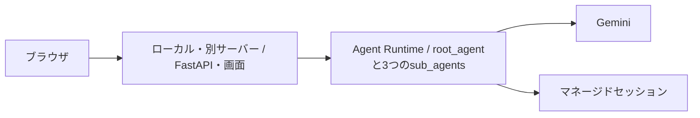
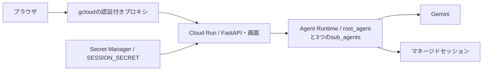

# CLIでデプロイする：Agent Runtime + Cloud Run

このリポジトリを、公式CLIとREST APIでデプロイ・確認・更新するチュートリアルです。`scripts/deploy_agent.py` などの独自Pythonスクリプトは使いません。ローカルでADK Webの動作確認ができていることを前提にします。

この文書のコマンドは開発・デプロイ担当者の専用アカウントで実行します。API・IAM・実行アカウント・Secret・Cloud Runのアクセス設定は [管理者用の準備・アクセス設定](cloudrun-agent-runtime-admin.md) を依頼します。

**最初はAgent Runtimeだけをデプロイし、アプリをローカル・別サーバーで動かせます。** その場合は手順1〜6まで進め、Cloud Run用ロールの追加依頼と手順7は移行時に実施します。

| 利用段階 | 開発・デプロイ担当者が進める手順 | 管理者へ依頼するロール |
| --- | --- | --- |
| 第1段階：Agent Runtime＋ローカル・別サーバー | 手順1〜6 | [手順3.2](#32-agent-runtime用のロールと初期設定を依頼する) |
| 第2段階：Cloud Runへ移行 | 手順7 | [手順7.1](#71-cloud-run用の追加ロールと準備を依頼する) |

## 第1段階：Agent Runtime＋ローカル・別サーバー

## 1. どのCLIで何をするか

| 操作 | 使用するコマンド |
| --- | --- |
| 担当者の認証 | `gcloud` |
| Agent Runtime用APIの有効化、IAMの準備 | 管理者が別の手順で `gcloud` を実行 |
| エージェントをAgent Runtimeにデプロイ | `uv run --locked adk deploy agent_engine` |
| Agent Runtimeの一覧・疎通確認・削除 | `curl` + `gcloud auth print-access-token` |

確認したGoogle Cloud CLI 588.0.0の `gcloud ai` には、Agent RuntimeへADKエージェントを直接デプロイするコマンドがありません。その部分には公式ADK CLIを使います。サービス名はAgent Runtimeですが、ADK CLIのサブコマンド名は `agent_engine`、RESTリソース名は `reasoningEngines` です。[公式ADK CLI仕様](https://adk.dev/api-reference/cli/#agent-engine)

この段階では、ローカル・別サーバーのアプリがAgent Runtimeを呼びます。



この手順は `uv.lock` の **google-adk 2.11.0 / google-cloud-aiplatform 1.165.1** に合わせています。ADK CLIはソースと生成したDockerfileを送ってコンテナをビルドします。既存のPythonスクリプトは `AdkApp` をシリアライズして送る方式で、ステージングバケットが必要です。ここで使うCLI方式では `--staging_bucket` は不要です。[公式デプロイ方式](https://docs.cloud.google.com/gemini-enterprise-agent-platform/scale/runtime/deploy-an-agent)、[ADKのCLI実装](https://github.com/google/adk-python/blob/v2.11.0/src/google/adk/cli/cli_deploy.py)

既存のPython方式のエージェントを使い続ける場合は、手順5の新規デプロイを省いて、その完全なリソース名を設定できます。CLI方式を初めて試す場合は別のAgent Runtimeリソースを作り、新しい会話で確認してください。両方式はセッションのアプリ名が異なるため、既存の会話をそのまま移行する手順にはしていません。

## 2. ツールと変数を準備する

コマンドはbash/zsh用です。リポジトリのルートで、同じターミナルから順に実行してください。各コマンドが成功したことを確認してから次へ進みます。必要なツールは次のとおりです。

| ツール | 用途・導入方法 |
| --- | --- |
| Python 3.13 / uv | このリポジトリとADK CLI。`uv python install 3.13`、`uv sync --locked` |
| Google Cloud CLI | [公式インストール手順](https://docs.cloud.google.com/sdk/docs/install-sdk) |
| curl / jq | REST通信、JSON作成・読み取り。Ubuntu/WSLでは `sudo apt-get install curl jq` |

手元のDockerは不要です。Agent Runtimeのビルドはクラウドで行います。課金が有効なGoogle Cloudプロジェクトを用意してください。

```bash
uv python install 3.13
uv sync --locked
gcloud --version
jq --version
uv run --locked adk deploy agent_engine --help

export PROJECT_ID="your-project-id"
export DEPLOYER_EMAIL="you@example.com"
export REGION="us-central1"
export AGENT_DISPLAY_NAME="helpdesk-agent-cli"
export GEMINI_MODEL="gemini-3.5-flash"
export MODEL_LOCATION="global"
export GOOGLE_CLOUD_PROJECT="$PROJECT_ID"
export GOOGLE_CLOUD_LOCATION="$REGION"
export API_ENDPOINT="https://${REGION}-aiplatform.googleapis.com"
export CLI_WORKDIR="$(pwd)/.deploy/cli"
export AGENT_SOURCE="$CLI_WORKDIR/source/helpdesk"
mkdir -p "$CLI_WORKDIR"
```

プロジェクトIDとメールアドレスは実際の値に置き換えます。`GEMINI_MODEL` と `MODEL_LOCATION` はローカルで動作確認した組み合わせに合わせてください。`REGION` はRuntimeの配置先、`MODEL_LOCATION` はGeminiの接続先です。

## 3. Google Cloudを準備する

### 3.1 デプロイ者のログイン

```bash
gcloud auth login "$DEPLOYER_EMAIL"
gcloud config set account "$DEPLOYER_EMAIL"
gcloud config set project "$PROJECT_ID"
gcloud auth application-default login
```

`gcloud` と後述の `curl` はCLIのログインを使い、Pythonで実装された公式ADK CLIはADCを使います。同じデプロイ者のアカウントでログインしてください。サービスアカウントの鍵ファイルをダウンロードする必要はありません。[ADCのローカル設定](https://docs.cloud.google.com/docs/authentication/set-up-adc-local-dev-environment)

### 3.2 Agent Runtime用のロールと初期設定を依頼する

最初にプロジェクト・担当者メール・リージョンを管理者へ共有し、[管理者用手順1・2.1・3](cloudrun-agent-runtime-admin.md) のAgent Runtime用の準備を依頼します。この公式ADK CLI方式では、手順3.1のStorage用カスタムロールとバケット準備は不要です。

| ロール | 付与先のリソース | 用途 |
| --- | --- | --- |
| `roles/aiplatform.user` | プロジェクト | Agent Runtimeの配置・更新・削除・呼び出し、Gemini利用 |
| `roles/serviceusage.serviceUsageConsumer` | プロジェクト | API利用とADCの課金先指定 |
| `roles/logging.viewer` | プロジェクト | Agent Runtimeのログ確認 |

この3ロールとRuntime用APIの準備完了を受け取り、手順3.3以降へ進みます。Web/Buildサービスアカウント・Secret・Cloud Run用ロールは不要です。

Python方式も併用する場合は、Cloud Runのロールの付与を待たず [Python方式のStorage用ロール](cloudrun-agent-runtime.md#21-agent-runtime用のロール付与を依頼する) を依頼できます。

### 3.3 担当者の認証を確認する

管理者の準備完了後に担当者の端末で実行します。アクティブアカウントの出力が `$DEPLOYER_EMAIL` であることを確認します。以前Ownerを使っていた場合は、手順3.1でCLIとADCの両方を専用devアカウントへ切り替えてください。

```bash
gcloud auth application-default set-quota-project "$PROJECT_ID"
gcloud auth list --filter=status:ACTIVE --format='value(account)'
```

## 4. CLIが送るエージェントのソースを用意する

ADK CLIは指定したエージェントのディレクトリをコピーして送信します。ADK Webの `.adk/session.db` やローカルの `.env` を混ぜないよう、必要なファイルだけを `.deploy/cli/source/helpdesk` にコピーします。`.deploy` はGitとCloud Runのアップロード対象から除外済みです。

```bash
mkdir -p "$AGENT_SOURCE/data"
cp helpdesk/__init__.py helpdesk/agent.py helpdesk/tools.py "$AGENT_SOURCE/"
cp helpdesk/data/knowledge.json "$AGENT_SOURCE/data/"

cat > "$AGENT_SOURCE/requirements.txt" <<'EOF'
google-adk[a2a]==2.11.0
google-cloud-aiplatform[agent_engines,adk]==1.165.1
google-genai==2.28.0
cloudpickle==3.1.2
pydantic==2.13.5
python-dotenv==1.2.4
EOF

jq -n \
  --arg model "$GEMINI_MODEL" \
  --arg model_location "$MODEL_LOCATION" \
  '{
    min_instances: 0,
    max_instances: 2,
    env_vars: {
      GOOGLE_GENAI_USE_VERTEXAI: "true",
      GEMINI_MODEL: $model,
      MODEL_LOCATION: $model_location
    }
  }' > "$CLI_WORKDIR/agent-engine-config.json"

ls -R "$AGENT_SOURCE"
jq . "$CLI_WORKDIR/agent-engine-config.json"
```

送信する構成は以下です。

```text
.deploy/cli/
├── agent-engine-config.json
└── source/
    └── helpdesk/
        ├── __init__.py
        ├── agent.py          # root_agentと3つのsub_agents
        ├── tools.py          # 規程検索・購入額計算
        ├── requirements.txt
        └── data/knowledge.json
```

ディレクトリ名を `helpdesk` にしているのは、コードが `helpdesk.tools` をimportし、規程JSONも `helpdesk` パッケージから読むためです。Web側の `service.py` や `static/` はRuntimeのエージェントには不要で、Cloud Runへ送ります。

ADK CLIは `helpdesk/agent.py` の **`root_agent`** を入口として読み込み、子エージェントを含むチーム全体を1つのRuntimeへ配置します。`--display_name` はクラウドの表示名で、Pythonの変数名やエージェントの `name` を変える指定ではありません。

`requirements.txt` は現在のロックに合わせた主要依存の固定です。CLIが有効にするA2A用などの追加・間接依存はビルド時に解決されるため、`uv.lock` 全体を再現するものではありません。依存を更新したらこの一覧も見直してください。ADK 2.11.0が生成するRuntime用DockerfileはPython 3.11ベースで、Cloud Run用のリポジトリのDockerfileはPython 3.13ベースです。

モデルなどの設定はJSONに明示します。Runtimeに `SESSION_SECRET` は不要です。また、Runtimeの予約変数である `GOOGLE_CLOUD_PROJECT`・`GOOGLE_CLOUD_LOCATION`・`GOOGLE_APPLICATION_CREDENTIALS` をこのJSONへ追加しません。[Runtimeの環境変数設定](https://docs.cloud.google.com/gemini-enterprise-agent-platform/scale/runtime/deploy-an-agent#define-environment-variables)

## 5. 公式ADK CLIでAgent Runtimeへデプロイする

### 5.1 新規作成

```bash
uv run --locked adk deploy agent_engine \
  --project="$PROJECT_ID" \
  --region="$REGION" \
  --display_name="$AGENT_DISPLAY_NAME" \
  --agent_engine_config_file="$CLI_WORKDIR/agent-engine-config.json" \
  --temp_folder="$CLI_WORKDIR/build" \
  "$AGENT_SOURCE"
```

CLIがソースをコピーし、Dockerfileを生成してクラウドへ送信します。数分かかる場合があります。`--temp_folder` はCLIが作成・削除する専用の作業場所です。そこに保存したいファイルを置かないでください。`source/` と設定JSONは別の場所なので残ります。

ADKの引数は `--display_name` のようにアンダースコアです。従来の `--staging_bucket`・`--adk_app`・`--requirements_file`・`--env_file` はこの固定版では非推奨なので使いません。

成功時の **`Deployed to Agent Platform: projects/.../reasoningEngines/...`** に表示された完全なリソース名を設定します。途中の `Created a new instance` だけではデプロイ完了ではありません。

```bash
export AGENT_RESOURCE="projects/123456789/locations/us-central1/reasoningEngines/987654321"
export AGENT_ENGINE_RESOURCE_NAME="$AGENT_RESOURCE"
printf '%s\n' "$AGENT_RESOURCE" > "$CLI_WORKDIR/resource-name.txt"
```

この例の値は必ず成功ログの値に置き換えます。プロジェクト部分が数値でも問題ありません。CLIは既存のPythonスクリプトの `.deploy/agent.json` を更新しないため、以降はこの変数と `resource-name.txt` を使います。

### 5.2 RESTで配置結果を確認する

```bash
curl --fail-with-body --silent --show-error \
  -H "Authorization: Bearer $(gcloud auth print-access-token)" \
  "$API_ENDPOINT/v1/$AGENT_RESOURCE" \
  | jq '{name, displayName, createTime, updateTime, classMethods: .spec.classMethods}'
```

`classMethods` に `async_create_session`・`async_get_session`・`async_stream_query` などが登録されていることを確認します。CLIが起動するADK APIサーバーには `AdkApp` の互換APIがあり、既存の `APP_BACKEND=remote` の呼び出し方式に対応します。実際のモデル呼び出しと会話継続は次の手順で確認します。[CLI実装](https://github.com/google/adk-python/blob/v2.11.0/src/google/adk/cli/cli_deploy.py)、[ADK APIサーバー実装](https://github.com/google/adk-python/blob/v2.11.0/src/google/adk/cli/fast_api.py)

## 6. curlで質問し、同じセッションで会話を続ける

Cloud Runを追加する前に、エージェント単体を確認します。独自の `scripts/query_agent.py` は使いません。

### 6.1 セッションを作る

```bash
export TEST_USER_ID="cli-deployment-smoke"
jq -n --arg user_id "$TEST_USER_ID" \
  '{classMethod: "async_create_session", input: {user_id: $user_id}}' \
  > "$CLI_WORKDIR/create-session.json"

curl --fail-with-body --silent --show-error \
  -X POST \
  -H "Authorization: Bearer $(gcloud auth print-access-token)" \
  -H 'Content-Type: application/json' \
  --data-binary "@$CLI_WORKDIR/create-session.json" \
  "$API_ENDPOINT/v1/$AGENT_RESOURCE:query" \
  -o "$CLI_WORKDIR/session.json"

jq . "$CLI_WORKDIR/session.json"
export TEST_SESSION_ID="$(jq -er '.output.id | select(type == "string" and length > 0)' "$CLI_WORKDIR/session.json")"
```

`TEST_SESSION_ID` にIDが入ったことを確認します。REST側のフィールド名は `classMethod`、メソッドに渡す `input` 内の引数は `user_id`・`session_id` です。[公式query API](https://docs.cloud.google.com/gemini-enterprise-agent-platform/reference/rest/v1/projects.locations.reasoningEngines/query)

### 6.2 最初の質問

```bash
jq -n \
  --arg user_id "$TEST_USER_ID" \
  --arg session_id "$TEST_SESSION_ID" \
  --arg message '税込18万円のPCを2台購入したい' \
  '{classMethod: "async_stream_query", input: {
    user_id: $user_id, session_id: $session_id, message: $message
  }}' > "$CLI_WORKDIR/question.json"

curl --fail-with-body --silent --show-error --no-buffer \
  -X POST \
  -H "Authorization: Bearer $(gcloud auth print-access-token)" \
  -H 'Content-Type: application/json' \
  --data-binary "@$CLI_WORKDIR/question.json" \
  "$API_ENDPOINT/v1/$AGENT_RESOURCE:streamQuery?alt=sse"
```

返るのは整形済みの回答ではなくADKのイベントです。担当への引き継ぎ、ツール呼び出し、回答本文が含まれます。`estimate_purchase` と `search_it_knowledge` が使われ、税込合計 **360,000円**、承認者 **直属の上長と部門責任者**、参照規程 **IT-002** が期待値です。[SDKのストリーム呼び出し実装](https://github.com/googleapis/python-aiplatform/blob/v1.165.1/agentplatform/_genai/agent_engines.py)

### 6.3 同じ会話で続ける

```bash
jq -n \
  --arg user_id "$TEST_USER_ID" \
  --arg session_id "$TEST_SESSION_ID" \
  --arg message '1台なら合計と承認者はどうなる？' \
  '{classMethod: "async_stream_query", input: {
    user_id: $user_id, session_id: $session_id, message: $message
  }}' > "$CLI_WORKDIR/question.json"

curl --fail-with-body --silent --show-error --no-buffer \
  -X POST \
  -H "Authorization: Bearer $(gcloud auth print-access-token)" \
  -H 'Content-Type: application/json' \
  --data-binary "@$CLI_WORKDIR/question.json" \
  "$API_ENDPOINT/v1/$AGENT_RESOURCE:streamQuery?alt=sse"
```

税込 **180,000円**、承認者 **直属の上長** が期待値です。会話の継続には同じ `user_id` と `session_id` が必要です。同じセッションで `有給休暇は何日前までに申請する？`、`出張の宿泊費の上限は？` と質問を変えれば、人事・経理への振り分けも確認できます。

### 6.4 アプリをローカルで動かしてAgent Runtimeへ接続する

Cloud Runを使わず、既存の画面からクラウドのエージェントを確認できます。リポジトリのルートで次を実行し、http://localhost:8765 を開きます。

```bash
export APP_BACKEND="remote"
export AGENT_ENGINE_RESOURCE_NAME="$AGENT_RESOURCE"
export COOKIE_SECURE="false"
export SESSION_SECRET="$(uv run --locked python -c 'import secrets; print(secrets.token_urlsafe(32))')"
PORT=8765 uv run --locked python main.py
```

画面のモードが **Agent Runtime** になり、同じ会話で続けて質問できることを確認します。アプリは手元、Gemini呼び出しと会話状態はAgent Runtime上です。**第1段階はここで完了です。** この構成で利用を続ける場合は手順7を省き、更新時は手順8へ進みます。

別サーバーでも同じ `APP_BACKEND=remote` と完全なエージェントリソース名を使えます。そのサーバー上でアプリが使う認証主体へのAgent Runtimeアクセス権とADC、アプリ用の持続的な `SESSION_SECRET` を準備します。Cloud Run用ロールは不要です。認証の考え方は [開発者用ロール一覧](cloudrun-agent-runtime.md#21-agent-runtime用のロール付与を依頼する) を参照してください。

## 第2段階：Cloud Runへの移行（移行時のみ）

第1段階で配置したAgent Runtimeをそのまま使い、アプリをCloud Runに移します。ローカル・別サーバーで利用を続ける場合は、この段階を省きます。

完成する構成は次のとおりです。



## 7. gcloudで画面とAPIをCloud Runへデプロイする

| 操作 | 使用するコマンド |
| --- | --- |
| FastAPIと画面をCloud Runにデプロイ | `gcloud run deploy` |
| 非公開のCloud Runをブラウザで確認 | `gcloud run services proxy` |
| Cloud Run用API・IAM・実行アカウント・Secretの準備 | 管理者が別の手順で `gcloud` を実行 |

### 7.1 Cloud Run用の追加ロールと準備を依頼する

サービス名・Secret名・Web/Buildアカウントを管理者と決め、次を追加依頼します。

| ロール | 付与先のリソース | 用途 |
| --- | --- | --- |
| `roles/run.sourceDeveloper` | プロジェクト | Cloud Runのソースデプロイ・更新・削除 |
| `roles/iam.serviceAccountUser` | `$WEB_SA` と `$BUILD_SA` の各サービスアカウント | 指定アカウントを使ったデプロイ |
| `roles/secretmanager.viewer` | `$SECRET_NAME` のSecret | Secretのメタデータ・版の確認 |
| `roles/run.invoker` | `$SERVICE_NAME` のCloud Runサービス | 初回デプロイ後に依頼。プロキシでの動作確認 |
| `roles/iap.httpsResourceAccessor` | 対象のIAPアプリ | IAPでHTTPS URLを直接開く場合のみ |

Cloud Runのアクセス設定は管理者が行うため、担当者への `roles/run.admin` 付与は不要です。[公式ソースデプロイのIAM要件](https://docs.cloud.google.com/run/docs/deploying-source-code)

移行時には [管理者用手順2.2・3.2・4・5](cloudrun-agent-runtime-admin.md) も依頼し、Web/Buildアカウント・Secretの準備完了と、`SECRET_NAME`・数値の `SECRET_VERSION` を受け取ります。署名鍵の値を受け取る必要はありません。最初に付与したAgent Runtime用ロールは維持します。

管理者の準備完了後、共有された値を設定します。

```bash
export SERVICE_NAME="helpdesk-web"
export SECRET_NAME="helpdesk-session-secret"
export SECRET_VERSION="1"
export WEB_SA="helpdesk-web@${PROJECT_ID}.iam.gserviceaccount.com"
export BUILD_SA="helpdesk-builder@${PROJECT_ID}.iam.gserviceaccount.com"
```

共有された名前やSecretの版が異なる場合は値を合わせます。既存のリソースを再利用する場合は、管理者にもその名前を伝えて準備を依頼します。

### 7.2 管理者が準備したSecretを確認する

Cloud Run移行時に管理者が準備したSecretの名前・数値の版を使います。署名鍵は管理者が生成して保存しており、担当者は値を取得せずメタデータだけ確認します。

```bash
gcloud secrets versions describe "$SECRET_VERSION" \
  --secret="$SECRET_NAME" --project="$PROJECT_ID" \
  --format='yaml(name,state)'
```

`state: ENABLED` を確認します。Webアカウントには管理者が対象Secretの `roles/secretmanager.secretAccessor` を付与します。全Cloud Runインスタンスで同じ鍵を使い、通常の更新では作り直しません。[Cloud RunのSecret設定](https://docs.cloud.google.com/run/docs/configuring/services/secrets)

### 7.3 初回デプロイ

リポジトリのルートから実行します。`--source=.` はこのリポジトリの `Dockerfile` を使い、FastAPIと既存の画面を配置します。

```bash
gcloud run deploy "$SERVICE_NAME" \
  --project="$PROJECT_ID" --region="$REGION" \
  --source=. \
  --service-account="$WEB_SA" \
  --build-service-account="projects/$PROJECT_ID/serviceAccounts/$BUILD_SA" \
  --quiet \
  --min-instances=0 --max-instances=2 \
  --memory=1Gi --cpu=1 --timeout=180 \
  --set-env-vars="APP_BACKEND=remote,GOOGLE_CLOUD_PROJECT=$PROJECT_ID,GOOGLE_CLOUD_LOCATION=$REGION,AGENT_ENGINE_RESOURCE_NAME=$AGENT_RESOURCE,COOKIE_SECURE=false" \
  --set-secrets="SESSION_SECRET=$SECRET_NAME:$SECRET_VERSION"

gcloud run services describe "$SERVICE_NAME" \
  --project="$PROJECT_ID" --region="$REGION" \
  --format='yaml(status.url,status.latestReadyRevisionName,status.conditions,spec.template.spec.serviceAccountName)'
```

`Ready=True` と `$WEB_SA` を確認します。`APP_BACKEND=remote` と `AGENT_ENGINE_RESOURCE_NAME` が、画面から接続するエージェントの指定です。ローカルの `.env`、ADC、`.deploy`、`.adk` はCloud Runのソースに含めません。[gcloud run deploy仕様](https://docs.cloud.google.com/sdk/gcloud/reference/run/deploy)

新規サービスはデフォルトで認証必須です。アクセス権の設定は管理者が行うため、IAM変更を要求する `--allow-unauthenticated` / `--no-allow-unauthenticated` は指定しません。既存サービスのアクセス設定は維持されるので、再利用時は事前に管理者へ非公開設定の確認を依頼します。[Cloud Runの認証](https://docs.cloud.google.com/run/docs/authenticating/overview)

`adk deploy cloud_run` はADK APIサーバーをCloud Runへ配置する別のコマンドです。このリポジトリのFastAPIと画面を配置するため、ここでは `gcloud run deploy --source=.` を使います。

### 7.4 非公開のサービスをブラウザで開く

管理者へ初回デプロイの完了とプロジェクト・リージョン・サービス名・担当者メールを連絡し、[管理者用手順6](cloudrun-agent-runtime-admin.md#6-cloud-run作成後にアクセスを設定する) の非公開設定確認と、対象サービス上の `roles/run.invoker` 付与を依頼します。設定完了後に担当者が次を実行します。

```bash
gcloud run services proxy "$SERVICE_NAME" \
  --project="$PROJECT_ID" --region="$REGION" --port=8765
```

http://localhost:8765 を開きます。このURLの画面とAPIはCloud Run上、エージェントと会話状態はAgent Runtime上で動きます。手元で8765番を使うアプリがあれば、プロキシのポートを変更してください。

画面が **Agent Runtime** と表示されること、PCの質問と続きの質問に回答すること、担当と参照規程が表示されることを確認します。`/healthz` はWebサーバーの起動確認のみなので、質問を送ってRuntimeへの接続も確認してください。

`COOKIE_SECURE=false` は、このHTTPのローカルプロキシからCookieを送るための設定です。Cloud RunのHTTPS URLをブラウザで直接開く構成に進む場合は、[IAPの設定手順](cloudrun-agent-runtime.md#7-cloud-runのurlをブラウザで直接使うiap)に従い、`COOKIE_SECURE=true` へ変更します。[Cloud Runの開発用プロキシ](https://docs.cloud.google.com/run/docs/authenticating/developers)

## 運用：更新・調査・削除

以降は必要になったときに実施します。Cloud Runの操作は、第2段階を実施した場合だけ行います。

## 8. 更新する

Agent Runtimeだけを使っている場合は手順8.1を行い、Cloud Runも配置した場合のみ8.2を行います。ターミナルを開き直した場合は手順2の変数と `AGENT_RESOURCE` を再設定し、Cloud Run更新時には手順7.1の変数も再設定します。

### 8.1 エージェント・ツール・規程・モデルを更新する

手順4を再実行してソース、依存、設定JSONを更新し、既存IDを指定してデプロイします。

```bash
export AGENT_RESOURCE="$(cat "$CLI_WORKDIR/resource-name.txt")"
export AGENT_ENGINE_RESOURCE_NAME="$AGENT_RESOURCE"
export AGENT_ENGINE_ID="${AGENT_RESOURCE##*/}"

uv run --locked adk deploy agent_engine \
  --project="$PROJECT_ID" \
  --region="$REGION" \
  --agent_engine_id="$AGENT_ENGINE_ID" \
  --display_name="$AGENT_DISPLAY_NAME" \
  --agent_engine_config_file="$CLI_WORKDIR/agent-engine-config.json" \
  --temp_folder="$CLI_WORKDIR/build" \
  "$AGENT_SOURCE"
```

`--agent_engine_id` に渡すのは末尾のIDです。`PROJECT_ID` と `REGION` がリソース名のプロジェクト・リージョンに対応していることを確認します。この指定を省くと別のエージェントが新規作成されます。更新後は手順6を新しいセッションで確認してください。

### 8.2 画面・FastAPI・表示用の規程データを更新する

```bash
gcloud run deploy "$SERVICE_NAME" \
  --project="$PROJECT_ID" --region="$REGION" \
  --source=. \
  --service-account="$WEB_SA" \
  --build-service-account="projects/$PROJECT_ID/serviceAccounts/$BUILD_SA" \
  --update-env-vars="APP_BACKEND=remote,GOOGLE_CLOUD_PROJECT=$PROJECT_ID,GOOGLE_CLOUD_LOCATION=$REGION,AGENT_ENGINE_RESOURCE_NAME=$AGENT_RESOURCE" \
  --update-secrets="SESSION_SECRET=$SECRET_NAME:$SECRET_VERSION"
```

更新では `--update-env-vars` を使い、既存のCookie設定などを維持します。規程JSONを変更した場合はRuntimeとCloud Runの両方を更新してください。Runtimeは検索に、Cloud Runは画面の規程一覧と参照タイトルの表示にこのJSONを使います。Agent RuntimeのモデルはRuntime側で設定するため、Cloud Runだけ更新してもモデルは変わりません。

## 9. 状態確認とトラブル時のコマンド

### Agent Runtimeの一覧

```bash
curl --fail-with-body --silent --show-error \
  -H "Authorization: Bearer $(gcloud auth print-access-token)" \
  "$API_ENDPOINT/v1/projects/$PROJECT_ID/locations/$REGION/reasoningEngines?pageSize=100" \
  | jq '{agents: [.reasoningEngines[]? | {name, displayName}], nextPageToken}'
```

`nextPageToken` がある場合は、次のリクエストに `pageToken` を追加して続きも取得します。

### ログ

```bash
gcloud logging read \
  "resource.type=cloud_run_revision AND resource.labels.service_name=$SERVICE_NAME" \
  --project="$PROJECT_ID" --limit=30 --format=json

gcloud logging read \
  "resource.type=aiplatform.googleapis.com/ReasoningEngine AND resource.labels.reasoning_engine_id=${AGENT_RESOURCE##*/}" \
  --project="$PROJECT_ID" --limit=30 --format=json
```

ログの読み取りには `roles/logging.viewer` などの権限が必要です。

| 症状 | 確認すること |
| --- | --- |
| ADK CLIの認証エラー | `gcloud auth application-default login` とADCのquota project。`gcloud auth login` だけではADCは設定されない |
| curlの401 / 403 | CLIのログインアカウント、対象プロジェクトの `aiplatform.user` |
| ソースのimportエラー | コピー先の名前が `helpdesk` か、`tools.py`・`__init__.py`・規程JSONがそろっているか |
| Cloud Runからの403 | `$WEB_SA` の `aiplatform.user`、指定したRuntimeのプロジェクト |
| Secretを読めない | `$WEB_SA` のSecret単位の読み取り権限と数値バージョン |
| セッションが続かない | 同じユーザーID・セッションIDか、別のRuntimeへ切り替えていないか |
| プロキシ経由でCookieが保持されない | `COOKIE_SECURE=false` か、アクセスするホスト名を途中で変えていないか |
| CLI内部で `vertexai.Client` のFutureWarning | 固定ADK 2.11.0のCLI内部が旧名前空間を使うため。リポジトリの独自スクリプトとは別で、警告だけではデプロイ失敗を意味しない。成功ログと疎通で確認する |

CLIにdry-runオプションはありません。送信前に手順4のファイルとJSONを確認します。デプロイの終了コードが失敗なら、途中でリソース名が出ていても成功と扱わず、エラーとログを確認してください。

## 10. このチュートリアルで作ったリソースを削除する

使い終えた場合だけ実行します。共有・再利用しているCloud Run、Secret、サービスアカウントは削除対象から外してください。

```bash
curl --fail-with-body --silent --show-error \
  -X DELETE \
  -H "Authorization: Bearer $(gcloud auth print-access-token)" \
  "$API_ENDPOINT/v1/$AGENT_RESOURCE?force=true" \
  -o "$CLI_WORKDIR/delete-operation.json"

jq . "$CLI_WORKDIR/delete-operation.json"
export DELETE_OPERATION="$(jq -er '.name' "$CLI_WORKDIR/delete-operation.json")"
```

Runtimeの削除は非同期です。返ったOperationを、完了するまで間隔を置いて確認します。

```bash
curl --fail-with-body --silent --show-error \
  -H "Authorization: Bearer $(gcloud auth print-access-token)" \
  "$API_ENDPOINT/v1/$DELETE_OPERATION" | jq .
```

`done=true` かつ `error` がないことが完了条件です。`force=true` はRuntimeの子リソースであるセッションなども削除します。[公式削除API](https://docs.cloud.google.com/gemini-enterprise-agent-platform/reference/rest/v1/projects.locations.reasoningEngines/delete)

Cloud Runも配置した場合のみ、次も実行します。

```bash
gcloud run services delete "$SERVICE_NAME" \
  --project="$PROJECT_ID" --region="$REGION"
```

Runtimeと、配置した場合のみCloud Runの削除完了後、不要になったロールの解除を管理者へ依頼します。Cloud Run用のSecret・Web/Buildサービスアカウントも用意した場合は、[管理者用手順9](cloudrun-agent-runtime-admin.md#9-利用終了時の管理者側の削除) の削除を依頼します。

Cloud Runのソースデプロイで作られるArtifact Registryの `cloud-run-source-deploy` リポジトリなど、ビルド成果物はサービス削除だけでは消えません。[Artifact Registry](https://console.cloud.google.com/artifacts)で対象イメージを確認し、不要なものの削除は管理者へ依頼します。共有リポジトリは維持します。CLI方式では、既存のPython方式で作ったステージングバケットを削除する必要はありません。

この手順のCLI引数・ソース構成は固定済みのローカルADKで確認しています。実プロジェクトへのデプロイと実モデルの疎通は手順5・6で、Cloud Runも使う場合は手順7でも確認してください。
