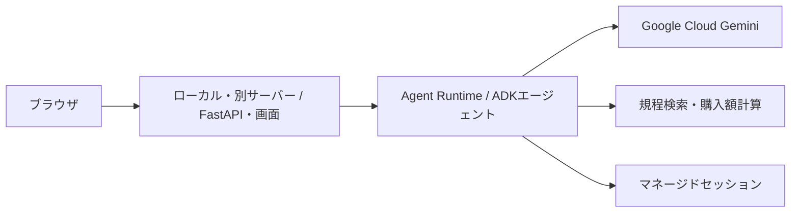
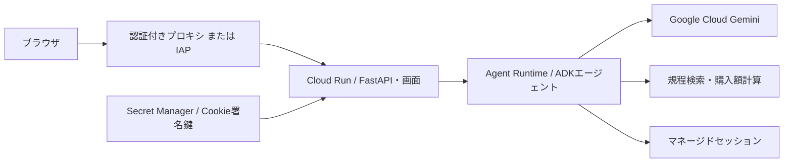

# ローカル確認後のデプロイ手順：Cloud Run + Agent Runtime

独自Pythonスクリプトを使わずに進めたい場合は [CLIでのデプロイ手順](cli-deploy.md) を使ってください。公式ADK CLIでAgent Runtimeを、`gcloud` でCloud Runを配置し、`curl` で会話の継続まで確認できます。この文書はPythonスクリプトを使う方式とIAP設定を説明します。

このリポジトリのエージェントを **Agent PlatformのAgent Runtime** にデプロイする手順です。まずアプリをローカル・別サーバーから接続し、必要になった段階でCloud Runへの移行を行います。

**この文書のコマンドは、開発・デプロイ担当者の専用アカウントで実行します。** API有効化、IAM変更、サービスアカウント・Secretの準備、Cloud Runのアクセス設定は管理者へ依頼します。最初に依頼するロールは手順2.1、Cloud Runへの移行時に追加するロールは手順5.1、管理者が実行するコマンドは [管理者用の準備・アクセス設定](cloudrun-agent-runtime-admin.md) にまとめています。

**まずAgent Runtimeだけをデプロイし、アプリをローカル・別サーバーで動かす場合は、手順1〜4まで進めます。** この段階ではCloud Run用のロール・Web/Buildアカウント・Secret Managerは不要です。Cloud Runへ移行するときに、手順5.1で追加権限と準備を依頼し、手順5以降を実施します。

コマンドはbash/zsh用です。リポジトリのルートで、同じターミナルを使って順に実行してください。`your-project-id` とメールアドレスは実際の値に置き換えます。既に作成・設定済みのリソースは再利用し、初回作成のコマンドをスキップします。

| 利用段階 | 開発・デプロイ担当者が進める手順 | 管理者へ依頼するロール |
| --- | --- | --- |
| 第1段階：Agent Runtime＋ローカル・別サーバー | 手順1〜4 | [手順2.1](#21-agent-runtime用のロール付与を依頼する) |
| 第2段階：Cloud Runへ移行 | 手順5〜7 | [手順5.1](#51-cloud-run用の追加ロールと準備を依頼する) |

## 第1段階：Agent Runtime＋ローカル・別サーバーの構成



アプリは `APP_BACKEND=remote` でAgent Runtimeを呼びます。Geminiの実行と会話状態はAgent Runtime側に置かれます。まず手順1〜4でこの構成を作ります。

エージェントは受付（`helpdesk_agent`）とIT・人事・経理の3つの `sub_agents` のチームです。`create_agent()` がチーム全体を返し、1つの `AdkApp` としてデプロイします。構成とADK Webでの確認方法は [README](../README.md#エージェントチームとadk-webでの確認) にあります。

## 1. 前提と変数をそろえる

必要なのは、ローカル確認で使ったPython 3.13・uvに加え、[Google Cloud CLI](https://docs.cloud.google.com/sdk/docs/install-sdk)です。

```bash
uv --version
gcloud --version
uv sync --locked

export PROJECT_ID="your-project-id"
export DEPLOYER_EMAIL="you@example.com"
export REGION="us-central1"
export STAGING_BUCKET="${PROJECT_ID}-agent-staging"

export GOOGLE_CLOUD_PROJECT="$PROJECT_ID"
export GOOGLE_CLOUD_LOCATION="$REGION"
export GOOGLE_CLOUD_STAGING_BUCKET="gs://$STAGING_BUCKET"
export GOOGLE_GENAI_USE_VERTEXAI="true"
export GEMINI_MODEL="gemini-3.5-flash"
export MODEL_LOCATION="global"
export AGENT_SERVICE_ACCOUNT=""
```

`GEMINI_MODEL` と `MODEL_LOCATION` は、ローカルで実際のGemini呼び出しに成功した値に合わせてください。Agent Runtimeへのデプロイ後にも、手順4でモデル呼び出しと会話の継続を確認します。

`REGION` はAgent Runtimeの配置先、`MODEL_LOCATION` はモデルの接続先です。別リージョンを選ぶ場合は、[Agent Runtime対応リージョン](https://docs.cloud.google.com/gemini-enterprise-agent-platform/resources/agent-locations?hl=ja)とモデルの対応先を確認します。`global` は日本国内に処理を限定する指定ではありません。

`STAGING_BUCKET` は世界全体で一意の名前が必要です。`AGENT_SERVICE_ACCOUNT=""` は、この手順でデフォルトのAgent Runtime実行IDを使う指定です。独自の実行アカウントを使う場合は[補足](#補足-agent-runtimeの実行アカウントを指定する場合)を参照してください。

これらのシェル変数は `.env` より優先されます。ローカル確認用の `.env` を書き換える必要はありません。

## 2. 管理者へ準備を依頼し、開発者の認証を設定する

### 2.1 Agent Runtime用のロール付与を依頼する

ロールの付与対象は開発・デプロイ担当者（`user:$DEPLOYER_EMAIL`）です。この手順ではAgent Runtimeのデプロイとローカル・別サーバーからの利用に必要なロールだけを依頼します。

管理者へ `PROJECT_ID`、`DEPLOYER_EMAIL`、`REGION` と、Python方式で使う `STAGING_BUCKET` を共有します。

| ロール | 付与先のリソース | 用途・付与時期 |
| --- | --- | --- |
| `roles/aiplatform.user` | プロジェクト | Agent Runtimeの作成・更新・削除・呼び出し、Gemini利用 |
| `roles/serviceusage.serviceUsageConsumer` | プロジェクト | API利用とADCの課金先指定 |
| `roles/logging.viewer` | プロジェクト | Agent Runtimeのデプロイ・実行ログの確認 |
| `projects/$PROJECT_ID/roles/helpdeskBucketCreator`（カスタム） | プロジェクト | **Python方式で新規バケットを担当者が作る場合のみ**。`storage.buckets.create` だけを許可 |
| `projects/$PROJECT_ID/roles/helpdeskStagingUploader`（カスタム） | `$STAGING_BUCKET` のバケット | **Python方式のみ、バケット作成後**に付与。`storage.buckets.get` と `storage.objects.create/get/list` を許可 |
| `roles/iam.serviceAccountUser` | カスタムAgent Runtime実行アカウント | **デフォルト実行IDを使う場合は不要**。独自の実行アカウントを指定してデプロイする場合だけ依頼 |

2つのカスタムロールは管理者が [管理者用手順3.1](cloudrun-agent-runtime-admin.md#31-python方式のみstorageの権限を準備する) で作成します。既存バケットを再利用する場合はCreatorが不要です。公式ADK CLI方式ならステージングバケットと、この2ロールはいずれも不要です。

Python方式に必要なStorage権限は上記のカスタムロールで依頼します。`roles/storage.admin` の付与は不要です。[バケット作成の公式IAM要件](https://docs.cloud.google.com/storage/docs/creating-buckets)、[カスタムロールの公式手順](https://docs.cloud.google.com/iam/docs/creating-custom-roles)

アプリの実行場所とAgent Runtimeの配置先は独立しています。ローカルでは手順4の本人のADCを使います。別サーバーでは、そのサーバー上のアプリが使う認証主体にも `roles/aiplatform.user` を付与し、ADCと必要な課金先のAPI利用権限を設定してください。担当者のログインが別サーバーへ自動的に引き継がれるわけではありません。[ADCの設定方法](https://docs.cloud.google.com/docs/authentication/provide-credentials-adc)

### 2.2 管理者にクラウドの初期設定を依頼する

まずは [管理者用手順1・2.1・3](cloudrun-agent-runtime-admin.md) を依頼します。必要ならバケット作成後の手順3.1の権限付与も依頼します。Cloud Run用の準備は移行時まで不要です。

| 依頼内容 | 管理者から受け取る情報 |
| --- | --- |
| プロジェクトの課金確認と必要なAPIの有効化 | 準備済みの `PROJECT_ID` |
| 開発・デプロイ担当者へのAgent Runtime用ロール付与 | 設定完了の連絡 |
| Python方式のバケット作成用カスタムロールの準備 | Creator付与済みの連絡。Uploaderはバケット作成後に付与 |

ステージングバケットは、管理者の準備が完了した後に **担当者が手順2.4で作成**します。管理者用手順でもバケット作成は行いません。

### 2.3 開発・デプロイ担当者としてログインする

管理者の準備完了後、専用の開発・デプロイアカウントで実行します。

```bash
gcloud auth login "$DEPLOYER_EMAIL"
gcloud config set account "$DEPLOYER_EMAIL"
gcloud config set project "$PROJECT_ID"
gcloud auth application-default login
gcloud auth application-default set-quota-project "$PROJECT_ID"
gcloud auth list --filter=status:ACTIVE --format='value(account)'
```

ブラウザでADCにログインするときも、デプロイ者として権限を付与するアカウントを選びます。`gcloud auth login` はCLI用、`application-default login` は `uv run` から呼ぶPython SDK用です。Cloud Runには実行サービスアカウントの認証が渡されるため、ADCファイルやサービスアカウントのJSON鍵をアップロードしません。[公式認証設定](https://docs.cloud.google.com/gemini-enterprise-agent-platform/build/runtime/setup?hl=ja)

最後の出力が `$DEPLOYER_EMAIL` であることを確認します。Ownerでログインしていた端末では、CLIのアクティブアカウントとADCの両方を切り替えてください。CLIとADCは独立した認証です。

### 2.4 ステージングバケットを作る【担当者・初回】

この文書のPythonスクリプト方式はADKオブジェクトをシリアライズして送るため、ステージング用Cloud Storageバケットが必要です。同じプロジェクトに作成します。対して [公式ADK CLI方式](cli-deploy.md) は、固定したADK 2.11.0ではソースを送るため、このステージングバケットを用意する必要はありません。[公式ステージング設定](https://docs.cloud.google.com/gemini-enterprise-agent-platform/build/runtime/setup?hl=ja)、[固定ADKのCLI実装](https://github.com/google/adk-python/blob/v2.11.0/src/google/adk/cli/cli_deploy.py)

```bash
gcloud storage buckets create "gs://$STAGING_BUCKET" \
  --project="$PROJECT_ID" --location="$REGION" \
  --uniform-bucket-level-access
```

作成後、管理者へバケット名を連絡し、[管理者用手順3.1](cloudrun-agent-runtime-admin.md#31-python方式のみstorageの権限を準備する) のUploader付与を依頼します。Creatorにはバケットの読み取り権限がないため、付与完了後に以下を確認して手順3へ進みます。既存バケットの場合は作成を省き、Uploader付与から進めます。

```bash
gcloud storage buckets describe "gs://$STAGING_BUCKET"
```

Uploaderはこのバケットだけに付与され、SDKによるファイル保存・読み取りとバケット確認に使います。バケットIAMの変更と保存ファイル・バケットの削除は管理者が担当します。Agent Runtimeのデフォルトサービスエージェントはデプロイ時に自動作成されます。[公式実行ID設定](https://docs.cloud.google.com/gemini-enterprise-agent-platform/build/runtime/setup?hl=ja#configure-agent-identity)

## 3. Agent Runtimeへエージェントをデプロイする

### 3.1 送信する設定を確認する

```bash
uv run --locked python -m scripts.deploy_agent --dry-run
```

出力の `project`、`location`、`staging_bucket`、`GEMINI_MODEL`、`MODEL_LOCATION` を確認します。dry-runはGoogle Cloudに接続しません。

### 3.2 初回デプロイ

```bash
uv run --locked python -m scripts.deploy_agent \
  --display-name helpdesk-agent-poc
```

数分かかる場合があります。成功すると `.deploy/agent.json` に接続先が保存されます。スクリプトはローカルでインストールしたSDK・ADK等のバージョンを固定し、ツールと規程JSONを含む `helpdesk` パッケージを送ります。[公式Agent Runtimeデプロイ](https://docs.cloud.google.com/gemini-enterprise-agent-platform/scale/runtime/deploy-an-agent?hl=ja)

```bash
export AGENT_RESOURCE="$(uv run --locked python -c 'import json; from pathlib import Path; print(json.loads(Path(".deploy/agent.json").read_text())["resource_name"])')"
export AGENT_ENGINE_RESOURCE_NAME="$AGENT_RESOURCE"
printf '%s\n' "$AGENT_RESOURCE"
```

次の形式であれば、以降はこの完全なリソース名を使います。プロジェクト部分は数値になる場合があります。

```text
projects/123456789/locations/us-central1/reasoningEngines/987654321
```

既にAgent Runtimeへデプロイ済みなら、新規作成を省き、既存のリソース名を上の2つの変数に設定してください。コード変更時は手順8の `--update` を使います。新規デプロイを再実行すると別のエージェントが作られます。

クラウドへの接続は `agentplatform.Client().agent_engines` を使います。固定SDK 1.165.1ではこのクライアントが同梱されています。ADKの実行・デプロイ用ラッパーは `vertexai.agent_engines.AdkApp`、パッケージ名は `google-cloud-aiplatform`、リソース名は `reasoningEngines` です。SDKを2系へ更新するとAPI名も変わるため、この手順では `uv.lock` に固定した版を使います。[公式SDKリポジトリ](https://github.com/googleapis/python-aiplatform)

## 4. 手元からAgent Runtimeの疎通を確認する

Cloud Runを追加する前に、クラウドのエージェントが回答することを確認します。

```bash
export APP_BACKEND="remote"
export COOKIE_SECURE="false"
export SESSION_SECRET="$(uv run --locked python -c 'import secrets; print(secrets.token_urlsafe(32))')"

uv run --locked python -m scripts.query_agent \
  '税込18万円のPCを2台購入したい' --user-id deployment-smoke
```

合計 **360,000円**、承認者は **直属の上長と部門責任者**、参照は **IT-002** が期待値です。`tools_used` に `estimate_purchase` が含まれることも確認します。文面はモデルによって変わります。

出力の `session_id` を使うと、マネージドセッションで会話を継続できます。

```bash
uv run --locked python -m scripts.query_agent \
  '1台なら合計と承認者はどうなる？' \
  --user-id deployment-smoke --session-id '先ほど出力されたsession_id'
```

税込180,000円、直属の上長が期待値です。継続には同じ `user_id` と `session_id` を使います。

画面も手元で確認する場合は、次を実行し、http://localhost:8765 を開きます。モードが **Agent Runtime** になっていれば、手元の画面からクラウドのエージェントを利用しています。

```bash
PORT=8765 uv run --locked python main.py
```

**第1段階はここで完了です。** ローカル・別サーバーで利用を続ける場合は手順5〜7を省き、更新時は手順8へ進みます。別サーバーでの認証は手順2.1を参照してください。Cloud Runへ移行する場合はCtrl+Cでローカルサーバーを停止し、次へ進みます。

## 第2段階：Cloud Runへの移行（移行時のみ）

ここからの手順5〜7はCloud Runに移行するときに実施します。第1段階で配置したAgent Runtimeをそのまま使い、アプリをCloud Runに移します。



| 配置先 | 配置するもの | 使用する認証 |
| --- | --- | --- |
| Agent Runtime | ADKエージェント、ツール、`helpdesk` パッケージ、規程JSON | デフォルトのAgent Runtimeサービスエージェント |
| Cloud Run | `Dockerfile` から作るFastAPIアプリ・画面 | `helpdesk-web` サービスアカウント |
| Cloud Build | Cloud Run用コンテナのビルド | `helpdesk-builder` サービスアカウント |
| Secret Manager | 全Cloud Runインスタンスで共通の `SESSION_SECRET` | Cloud Run実行アカウントにSecret単位の読み取り権限 |
| 手元 | デプロイスクリプト、最初の疎通確認 | `gcloud` のログインとPython用ADC |

Cloud Runは `APP_BACKEND=remote` でAgent Runtimeを呼びます。Geminiの実行と会話状態はAgent Runtime側に置かれます。Cloud Runへのデプロイだけではエージェントは作られません。

Cloud Runへ移行した画面は、まずCloud Run IAMとローカルプロキシで確認します。Cloud RunのHTTPS URLをブラウザで直接使いたい場合は、[手順7のIAP](#7-cloud-runのurlをブラウザで直接使うiap)を設定します。

## 5. Cloud Runへ画面とAPIをデプロイする

### 5.1 Cloud Run用の追加ロールと準備を依頼する

この段階で `SERVICE_NAME`、`SECRET_NAME`、`WEB_SA`、`BUILD_SA` を管理者と決めます。Agent Runtime段階のロールは維持し、以下だけ追加依頼します。

| ロール | 付与先のリソース | 用途・付与時期 |
| --- | --- | --- |
| `roles/run.sourceDeveloper` | プロジェクト | Cloud Runのソースデプロイ・更新・削除 |
| `roles/iam.serviceAccountUser` | `$WEB_SA` と `$BUILD_SA` の各サービスアカウント | 指定アカウントを使ったデプロイ |
| `roles/secretmanager.viewer` | `$SECRET_NAME` のSecret | デプロイで参照するSecretのメタデータ・有効な版の確認 |
| `roles/run.invoker` | `$SERVICE_NAME` のCloud Runサービス | **初回デプロイ後**に付与。認証付きプロキシでの動作確認 |
| `roles/iap.httpsResourceAccessor` | 対象のIAPアプリ | **IAPを使う場合のみ**、管理者に付与を依頼。HTTPS URLをブラウザで開く |

`aiplatform.user`、`serviceusage.serviceUsageConsumer`、`logging.viewer` は第1段階で付与済みなので、追加依頼は不要です。[Source Developerの権限一覧](https://docs.cloud.google.com/run/docs/reference/iam/roles#cloud-run-source-developer)

Cloud Runのアクセス権・認証設定は管理者が担当するため、開発・デプロイ担当者への `roles/run.admin` 付与は不要です。Secretの値を直接読む権限も依頼しません。Cloud Runの実行アカウントが値を読み、担当者はSecretの名前と版を指定します。[ソースデプロイの公式IAM要件](https://docs.cloud.google.com/run/docs/deploying-source-code)、[Secret Managerのロール](https://docs.cloud.google.com/secret-manager/docs/access-control)

Cloud Runへの移行時に追加ロールと [管理者用手順2.2・3.2・4・5](cloudrun-agent-runtime-admin.md) を依頼します。Web/BuildアカウントとSecretを準備してもらい、`WEB_SA`、`BUILD_SA`、`SECRET_NAME` と数値の `SECRET_VERSION` を受け取ります。署名鍵の値を共有する必要はありません。Cloud Run Invokerはサービス作成後に別途依頼します。

管理者の準備完了後、共有された値を設定します。

```bash
export SERVICE_NAME="helpdesk-web"
export SECRET_NAME="helpdesk-session-secret"
export SECRET_VERSION="1"
export WEB_SA="helpdesk-web@${PROJECT_ID}.iam.gserviceaccount.com"
export BUILD_SA="helpdesk-builder@${PROJECT_ID}.iam.gserviceaccount.com"
```

管理者から共有された値が異なる場合はそちらに合わせます。WebアカウントはAgent Runtimeを呼び、BuildアカウントはCloud Run用コンテナをビルドします。ここではAgent Runtimeと同じプロジェクト・リージョンにCloud Runを配置します。

### 5.2 管理者が準備したSecretを確認する

手順5.1で管理者から受け取った `SECRET_NAME` と `SECRET_VERSION` を使います。すべてのCloud Runインスタンスが同じ署名鍵を使うことで、インスタンスをまたいでも同じブラウザの会話を扱えます。

Secretの値を取得せず、指定された版の状態を確認します。

```bash
gcloud secrets versions describe "$SECRET_VERSION" \
  --secret="$SECRET_NAME" --project="$PROJECT_ID" \
  --format='yaml(name,state)'
```

`state: ENABLED` を確認します。Secretが未準備、無効な版、Webアカウントのアクセス不足の場合は、[管理者用手順5](cloudrun-agent-runtime-admin.md#5-cookie署名鍵のsecretを準備する) の対応を依頼します。手順4のローカル確認用 `SESSION_SECRET` とクラウドの鍵は異なっていて構いません。通常のアプリ更新では鍵を作り直さず、数値の版を指定します。[Cloud RunのSecret利用](https://docs.cloud.google.com/run/docs/configuring/services/secrets)

### 5.3 初回デプロイ

開発・デプロイ担当者が実行します。アクセス権の設定は手順6.1で管理者へ依頼します。

`--source=.` はCloud Buildでリポジトリの `Dockerfile` をビルドするため、手元のDockerは不要です。[公式ソースデプロイ手順](https://docs.cloud.google.com/run/docs/deploying-source-code)

```bash
gcloud run deploy "$SERVICE_NAME" \
  --project="$PROJECT_ID" --region="$REGION" \
  --source=. \
  --service-account="$WEB_SA" \
  --build-service-account="projects/$PROJECT_ID/serviceAccounts/$BUILD_SA" \
  --quiet \
  --min-instances=0 --max-instances=2 \
  --memory=1Gi --cpu=1 --timeout=180 \
  --set-env-vars="APP_BACKEND=remote,GOOGLE_CLOUD_PROJECT=$PROJECT_ID,GOOGLE_CLOUD_LOCATION=$REGION,AGENT_ENGINE_RESOURCE_NAME=$AGENT_RESOURCE,COOKIE_SECURE=false" \
  --set-secrets="SESSION_SECRET=$SECRET_NAME:$SECRET_VERSION"
```

このコマンドはCloud Buildでコンテナを作成し、Cloud Runサービスを起動します。新規サービスはデフォルトで認証必須です。IAM変更を要求する `--allow-unauthenticated` / `--no-allow-unauthenticated` は指定せず、`--quiet` で対話を省きます。既存サービスのアクセス設定は維持されるため、Ownerで作った既存サービスを再利用する場合は、事前に管理者へ非公開設定の確認を依頼してください。[Cloud Runの認証の既定値](https://docs.cloud.google.com/run/docs/authenticating/overview)

コンテナはCloud Runが渡す `PORT` を使います。手元の8080番が使用中でもデプロイには影響しません。[公式コマンド仕様](https://docs.cloud.google.com/sdk/gcloud/reference/run/deploy)

`.env`・ADC・`.deploy` はソースに含まれません。Cloud Runの設定は上の環境変数とSecretから渡されます。`GEMINI_MODEL` と `MODEL_LOCATION` はAgent Runtimeのデプロイ時に設定済みで、Cloud Runに設定してもクラウドのエージェントのモデルは変わりません。

デプロイ結果を確認します。

```bash
gcloud run services describe "$SERVICE_NAME" \
  --project="$PROJECT_ID" --region="$REGION" \
  --format='yaml(status.url,status.latestReadyRevisionName,status.conditions,spec.template.spec.serviceAccountName)'
```

`Ready` が `True`、実行アカウントが `$WEB_SA` であることを確認します。

## 6. Cloud Run上のアプリを確認する

### 6.1 管理者へCloud Runのアクセス設定を依頼する

初回デプロイの完了を管理者へ連絡し、`PROJECT_ID`・`REGION`・`SERVICE_NAME`・`DEPLOYER_EMAIL` を共有します。[管理者用手順6](cloudrun-agent-runtime-admin.md#6-cloud-run作成後にアクセスを設定する) に従って、認証必須の確認と **対象サービス上の `roles/run.invoker`** の付与を依頼してください。サービスが作成されるまでは、サービス単位のロールを付与できません。

管理者から設定完了の連絡を受けたら、手順6.2へ進みます。サービスを削除して作り直した場合も、この依頼が必要です。

### 6.2 認証付きプロキシでブラウザから開く

利用者自身の `gcloud` ログインで、以下を実行します。

```bash
gcloud run services proxy "$SERVICE_NAME" \
  --project="$PROJECT_ID" --region="$REGION" --port=8765
```

プロキシを起動したまま http://localhost:8765 を開きます。手順4のローカルアプリは停止しておきます。このURLから開く画面とAPIは **Cloud Run上**、エージェントは **Agent Runtime上** で実行されています。[公式プロキシコマンド](https://docs.cloud.google.com/sdk/gcloud/reference/run/services/proxy)

プロキシコンポーネントが不足している場合は、アーカイブ版CLIなら `gcloud components install cloud-run-proxy`、apt版なら `sudo apt-get install google-cloud-cli-cloud-run-proxy` で追加します。

別のターミナルからHTTPも確認できます。

```bash
curl --fail http://localhost:8765/healthz
curl --fail http://localhost:8765/api/config
```

`/healthz` の `backend` が `remote` であることを確認します。ヘルスチェックだけではGeminiの応答までは検証できないため、画面で以下を試します。

| 操作 | 確認する結果 |
| --- | --- |
| 画面を開く | モード表示が「Agent Runtime」 |
| 「VPNに接続できない」 | VPN手順、参照IT-001 |
| 「税込18万円のPCを2台購入したい」 | 360,000円、上長と部門責任者、参照IT-002 |
| 続けて「1台なら？」 | 同じ会話で180,000円、上長 |
| 続けて「有給休暇は何日前までに申請？」 | IT → 受付 → 人事、原則3営業日前、参照HR-002 |
| 続けて「国内出張のホテル代の上限は？」 | 人事 → 受付 → 経理、1泊税込12,000円、参照FIN-002 |
| 回答の「担当」表示 | 受付・担当の実際の処理経路が表示される |
| 参照資料を開く | 規程の本文が表示される |
| 「新しい会話」 | 現在のセッションを削除し、新しい相談を開始 |

プロキシは手元のHTTPで開くため、ここまでは `COOKIE_SECURE=false` を使います。Cloud RunのURLを通常のブラウザで直接開くと、IAM認証用のトークンが付かず403になります。Googleアカウントにログイン済みでも、IAMだけではブラウザのログイン画面は提供されません。

## 7. Cloud RunのURLをブラウザで直接使う（IAP）

利用者へHTTPS URLを渡して使う場合は、Cloud RunにIAPを設定します。利用者はGoogleアカウントでログインし、IAPで許可されたユーザーが画面を開けます。[公式IAP設定手順](https://docs.cloud.google.com/run/docs/securing/identity-aware-proxy-cloud-run)

管理者へ [管理者用手順7](cloudrun-agent-runtime-admin.md#7-https-urlを直接使う場合のiap設定) の対応を依頼します。共有するのは対象プロジェクト・リージョン・サービス名と、利用を許可するユーザーまたはグループです。IAPの有効化とアクセス権の変更は管理者が行い、担当者・利用者には **対象アプリの `roles/iap.httpsResourceAccessor`** を付与してもらいます。担当者への `run.admin` や `iap.admin` の付与は不要です。

管理者がIAPを有効化した後、開発・デプロイ担当者がHTTPSに合わせてCookieの設定を変更します。

```bash
gcloud run services update "$SERVICE_NAME" \
  --project="$PROJECT_ID" --region="$REGION" \
  --update-env-vars=COOKIE_SECURE=true
gcloud run services describe "$SERVICE_NAME" \
  --project="$PROJECT_ID" --region="$REGION" \
  --format='value(status.url)'
```

表示されたHTTPS URLを開き、許可したアカウントでログインして質問します。IAP有効化後の確認はこのURLで行います。最初のアクセスでは新しい会話になります。

現在のアプリは署名付きCookieでブラウザを区別します。IAPのGoogleアカウントと会話のユーザーIDを結び付ける処理はまだありません。社員IDごとの履歴や文書アクセス制御が必要な場合は、その認証・認可をアプリに追加します。

## 運用：更新・調査・削除

以降は必要になったときに実施します。Cloud Runの操作は、第2段階を実施した場合だけ行います。

## 8. 更新するとき

### エージェントの指示・ツール・モデルを変更した場合

変更を検証して、既存のAgent Runtimeを更新します。

```bash
uv run --locked ruff check .
uv run --locked ruff format --check .
uv run --locked pytest -q
uv run --locked python -m scripts.deploy_agent --update "$AGENT_RESOURCE"
```

更新後に手順4のCLI疎通を再確認します。モデル変更では `GEMINI_MODEL` と `MODEL_LOCATION` を設定してから更新します。

### 画面・API・Python依存関係を変更した場合

Cloud Runを再デプロイします。以下は設定済みのIAM・IAP・`COOKIE_SECURE` を維持して、ソースと接続設定を更新するコマンドです。通常の更新では同じSecretの版を使います。

```bash
gcloud run deploy "$SERVICE_NAME" \
  --project="$PROJECT_ID" --region="$REGION" \
  --source=. \
  --service-account="$WEB_SA" \
  --build-service-account="projects/$PROJECT_ID/serviceAccounts/$BUILD_SA" \
  --update-env-vars="APP_BACKEND=remote,GOOGLE_CLOUD_PROJECT=$PROJECT_ID,GOOGLE_CLOUD_LOCATION=$REGION,AGENT_ENGINE_RESOURCE_NAME=$AGENT_RESOURCE" \
  --update-secrets="SESSION_SECRET=$SECRET_NAME:$SECRET_VERSION"
```

**`helpdesk/data/knowledge.json` は両方に同梱されます。規程を変更した場合はAgent RuntimeとCloud Runの両方を更新**して、回答と画面の参照資料をそろえます。ADK・SDKなどの依存関係を更新した場合も、両方を更新します。

署名鍵を変更する場合は、管理者へSecretの新しい版の作成を依頼します。通知された番号へ `SECRET_VERSION` を変更してCloud Runを更新します。旧Cookieが無効になり、利用者は新しい会話を開始します。

ターミナルを開き直した場合は、手順1の変数と手順3の `AGENT_RESOURCE` を再設定します。Cloud Run更新時は手順5.1の変数も再設定します。新規リソース作成・署名鍵保存・初回デプロイの手順を繰り返す必要はありません。

### 更新を戻す場合

Cloud Runはコンソールのリビジョン一覧で、動作していたリビジョンへトラフィックを戻せます。Agent Runtimeは更新前のコードと `uv.lock` を用意し、同じリソース名へ `--update` で再デプロイします。Cloud Runだけを戻してもAgent Runtimeの内容は戻らないため、規程・ツール・依存関係を変更した場合は両方の版を合わせます。

## 9. エラーを調べる

### デプロイ時に名前解決が失敗する場合

`httpx.ConnectError: [Errno -3] Temporary failure in name resolution` は、APIへ接続する段階でホスト名の名前解決に失敗したエラーです。旧コードで表示された `vertexai.Client` の `FutureWarning` は非推奨APIの通知で、このDNSエラーの原因ではありません。2026-10-13に `agentplatform.Client` へ移行しているため、現在のコードではその警告は出ません。

デプロイを実行した環境で、認証情報を送らずに接続先への疎通を確認します。`us-central1` 以外を設定した場合は、ホスト名のリージョンも合わせてください。[公式の地域別API接続先](https://docs.cloud.google.com/gemini-enterprise-agent-platform/scale/runtime/use-an-adk-agent?hl=en)

```bash
curl --silent --show-error --output /dev/null \
  --write-out 'HTTP=%{http_code}\n' \
  --connect-timeout 5 --max-time 10 \
  https://us-central1-aiplatform.googleapis.com/
```

ルートURLの `HTTP=404` はこの確認では正常です。DNS解決・HTTPS接続ができ、HTTP応答が返ったことを示します。`Could not resolve host` / `HTTP=000` なら、まず実行環境のDNS・ネットワークを確認します。

Codexなどのネットワーク制限付き実行環境で失敗する場合は、通常のターミナルでも同じ確認を行います。通常のターミナルで接続できるなら、必要なシェル変数をその端末で設定し、そこからデプロイを再実行します。

```bash
uv run --locked python -m scripts.deploy_agent --display-name helpdesk-agent-poc
```

通常のターミナルでも名前解決できない場合は、VPN・プロキシ・コンテナ/WSLのDNS設定や組織の通信制限を確認します。IAMの変更やSDKのアップグレードだけではDNSは復旧しません。

### Cloud RunやAgent Runtimeのログを確認する

まずCloud Runのログを確認します。画面のエラー表示はSDKの詳細を伏せているため、原因はサーバー側のログで調べます。

```bash
gcloud run services logs read "$SERVICE_NAME" \
  --project="$PROJECT_ID" --region="$REGION" --limit=100
```

Agent Runtimeのデプロイ失敗・モデル呼び出し失敗は、コンソールで対象Agent Runtimeのログを開きます。Cloud Buildの失敗は、デプロイコマンドが表示するビルドログURLで確認します。

| 症状 | 主に確認する箇所 |
| --- | --- |
| `Temporary failure in name resolution` | 上のDNS疎通確認。制限付き実行環境と通常のターミナルで結果を比較 |
| Agentデプロイ時にADCエラー | Python用ADCのログイン、ADCの課金先、`GOOGLE_CLOUD_PROJECT` |
| ステージングで403 | バケットの存在、同じプロジェクトのバケットか、対象バケット上のUploader付与（`storage.buckets.get` と `storage.objects.create/get/list`） |
| バケット作成が403 | 対象プロジェクト上のCreator付与と `storage.buckets.create`、組織ポリシー |
| Agent作成・呼び出しが403 | API・課金、呼び出す本人/SAの `aiplatform.user`、組織ポリシー |
| Geminiのモデル404 | ローカルと同じモデル・接続先か、モデルの提供状況 |
| Cloud Buildが失敗 | `BUILD_SA` の `run.builder`、デプロイ者がBuild SAを使用する権限、ビルドログ |
| Cloud RunがReadyにならない | Secretの有効な版、`WEB_SA` のSecretアクセス、Agentの完全なリソース名・project/location |
| 手順4は成功するがCloud Runから質問できない | `WEB_SA` の `aiplatform.user`、Cloud Runに設定されたAgentリソース名、Agent Runtimeのログ |
| Cloud Run URLで403 | IAMプロキシを使っているか、IAP設定・利用者のIAP権限 |
| 専用devアカウントへ切り替えても権限が変わらない | CLIのアクティブアカウントとADCを両方切り替えたか。`GOOGLE_APPLICATION_CREDENTIALS` を設定している場合は別の認証ファイルが優先される |
| 同じuser_id/session_idでもCLIの継続が `SessionNotFound` になる | remoteの取得結果は `userId`、localは `user_id` を使う場合がある。2026-10-13の修正を含む `helpdesk/service.py` を使用。手元のCLIは再実行、Cloud Runは再デプロイ |
| 会話が毎回切れる・既存会話が404 | Cookie許可、同じ署名鍵、プロキシはSecure=false / HTTPS直接利用はtrue、同じuser_id/session_id |
| 8765番が使用中 | 手順4のローカルサーバーを停止、プロキシを別ポートで起動 |
| 回答が504 | アプリの質問タイムアウトは120秒。Cloud Runの180秒設定だけを増やしても変わらない。Agentのログ・モデル応答時間を確認 |

## 10. 利用を終えたら削除する

以下はこのPoC専用に作ったリソースに実行します。Agent Runtime削除は会話セッションも削除します。

```bash
uv run --locked python -m scripts.delete_agent "$AGENT_RESOURCE"
```

Cloud Runも配置した場合のみ、次も実行します。

```bash
gcloud run services delete "$SERVICE_NAME" \
  --project="$PROJECT_ID" --region="$REGION"
```

Agent Runtimeの削除は非同期です。コンソールで削除完了を確認します。

```bash
unset SESSION_SECRET
```

専用ステージングバケットと保存ファイル・Secret・Web/Buildサービスアカウントの削除、不要になった開発者ロールの解除は [管理者用手順9](cloudrun-agent-runtime-admin.md#9-利用終了時の管理者側の削除) を依頼します。Python方式で使った `STAGING_BUCKET` の名前も管理者に共有してください。Source Developerには `storage.objects.delete` と `storage.buckets.delete` が含まれないため、担当者側ではバケットを削除しません。

Cloud Runのサービス削除では、Artifact RegistryのコンテナイメージやCloud Buildの保存ソース・ログはすべて削除されません。不要なビルド成果物も管理者へ削除を依頼します。既存の共有リポジトリ・バケットはそのまま使います。

最小インスタンスは0、最大は2ですが、利用額の上限ではありません。モデル・ランタイム・Cloud Run・ビルド・Storage・Secretなどの料金が関係します。[Agent Platform料金](https://cloud.google.com/vertex-ai/pricing)、[Cloud Run料金](https://cloud.google.com/run/pricing)

## 補足: Agent Runtimeの実行アカウントを指定する場合

この手順のデフォルト実行IDに代えて、カスタムサービスアカウントを使う場合は、[管理者用手順8](cloudrun-agent-runtime-admin.md#8-任意agent-runtimeの実行アカウントを指定する) を依頼します。管理者が専用アカウントを作成して `roles/aiplatform.user` を付与し、担当者にそのアカウントの `roles/iam.serviceAccountUser` を付与します。準備完了後、担当者が次を設定します。

```bash
export AGENT_SA="helpdesk-agent@${PROJECT_ID}.iam.gserviceaccount.com"
export AGENT_SERVICE_ACCOUNT="$AGENT_SA"
```

手順3のデプロイ前に設定してください。Web・Buildアカウントとは別の実行アカウントです。[公式カスタムサービスアカウント設定](https://docs.cloud.google.com/gemini-enterprise-agent-platform/build/runtime/setup?hl=ja#configure-agent-identity)

---

2026-10-13に公式IAM要件とこのリポジトリのスクリプト・設定項目を照合し、開発・デプロイ担当者と管理者の作業を分けています。この文書の改訂では、実際のGoogle CloudへのデプロイやIAM変更は実行していません。対象プロジェクトで手順4、Cloud Runも使う場合は手順6（IAP利用時は7）まで確認してください。初回インストールを含む説明は[セットアップ・デプロイ手順](setup-deploy.md)にあります。
